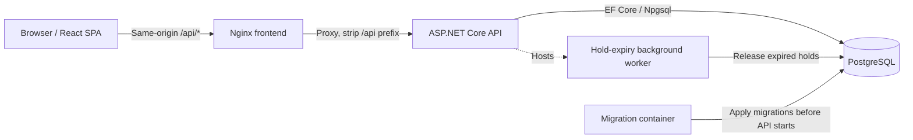
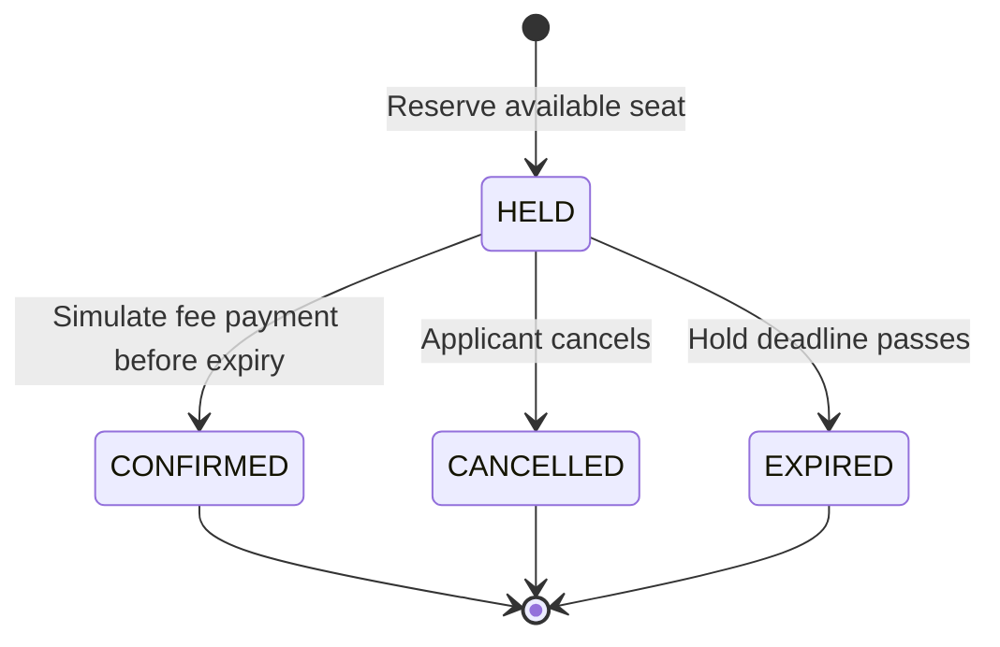

# Onnorokom School — Admission System

**A concurrency-safe, first-come-first-served school admission platform.** Built for the OnnoRokom Projukti Limited Assistant Software Engineer take-home assignment.

> **Reviewer quick start:** From the repository root, run `docker compose up`. Open **http://localhost:3000** for the web app and **http://localhost:8080/health** for the backend. Docker Compose builds and starts the frontend, API, database migration, and PostgreSQL services. No host .NET, Node.js, or PostgreSQL installation is required.

## Contents

- [Overview](#overview)
- [Technology stack](#technology-stack)
- [Run locally with Docker](#run-locally-with-docker)
- [Architecture](#architecture)
- [Admission lifecycle](#admission-lifecycle)
- [Seat safety and concurrency](#seat-safety-and-concurrency)
- [API reference](#api-reference)
- [Configuration](#configuration)
- [Frontend experience](#frontend-experience)
- [Reliability and observability](#reliability-and-observability)
- [Testing and bonus requirements](#testing-and-bonus-requirements)
- [Project layout](#project-layout)
- [Design decisions and scope](#design-decisions-and-scope)
- [Assignment compliance](#assignment-compliance)

## Overview

The system models a school where places are allocated **first come, first served**—not by lottery. Each class/shift combination is a separately managed class with its own seat capacity (for example, `Class 6 – Morning Shift`). A student identified by a **17-digit birth registration number** may temporarily reserve a seat, simulate paying the admission fee to confirm it, or cancel the application. An expired reservation releases its seat for other applicants.

### Core capabilities

- Admin creates classes with names and seat capacities.
- Applicants browse live seat counts: **total**, **held**, **confirmed**, and **available**.
- Seat holds have configurable expiry and a live countdown.
- Fee payment is **simulated**, not integrated with a payment gateway.
- Applicants view, confirm, and cancel their own applications.
- Expired holds release capacity even when nobody calls an API.
- PostgreSQL-backed locking prevents overselling under concurrent requests.
- UI supports Bangla/English guidance, friendly errors, and recovery states.

## Technology stack

| Layer            | Technology                                       | Purpose                                                   |
| ---------------- | ------------------------------------------------ | --------------------------------------------------------- |
| Backend          | C#, ASP.NET Core **10**                          | HTTP API, validation, business rules, background services |
| Persistence      | PostgreSQL **17**, Entity Framework Core, Npgsql | Durable transactional storage                             |
| Frontend         | React **19**, TypeScript, Vite                   | Responsive single-page application                        |
| UI               | Tailwind CSS                                     | Styling and responsive layout                             |
| Reverse proxy    | Nginx                                            | Serves frontend and forwards `/api/*` requests            |
| Infrastructure   | Docker, Docker Compose                           | Reproducible multi-service startup                        |
| Backend testing  | xUnit, Testcontainers                            | API, database, and concurrency verification               |
| Frontend testing | Vitest, React Testing Library, Playwright        | Component and browser-level verification                  |

The assignment requires **.NET 8+, PostgreSQL, React 18+, and Docker**; the selected versions meet those minimums.

## Run locally with Docker

### Prerequisites

- Docker Engine or Docker Desktop with the Compose plugin.
- Internet access on the first run to download base images and restore dependencies.

### 1. Start the complete system

```bash
docker compose up
```

Compose builds missing images and starts PostgreSQL, database migration, backend, and frontend. Wait until the migration finishes and the application services are ready.

### 2. Open the application

| Service                    | Address                            |
| -------------------------- | ---------------------------------- |
| Web application            | http://localhost:3000              |
| Backend API                | http://localhost:8080              |
| Backend liveness           | http://localhost:8080/health       |
| Backend readiness          | http://localhost:8080/health/ready |
| API through frontend proxy | http://localhost:3000/api/classes  |

**First-use walkthrough:** Create a class on the **Admin** page → enter a 17-digit birth registration number → browse classes → hold a seat → inspect the countdown → select **Pay Fee** to simulate confirmation, or cancel → inspect **My Applications**.

### 3. Stop without deleting data

```bash
docker compose down
```

The PostgreSQL **named volume** preserves database data across ordinary container restarts and `docker compose down` / `docker compose up`. **Do not use `docker compose down -v`** if you want to retain records.

### 4. Useful diagnostics

```bash
docker compose ps
docker compose logs -f backend
docker compose logs -f frontend
curl -i http://localhost:8080/health/ready
curl -i http://localhost:3000/api/classes
```

## Architecture



**Request flow:** Browser requests use relative `/api/*` paths. Nginx routes these to the backend; for example, `/api/classes` becomes backend `/classes`. This avoids exposing the internal Docker service name to browser JavaScript.

## Admission lifecycle



- A hold starts in `HELD` and expires after `HOLD_DURATION_SECONDS` (default: **600 seconds**).
- A successful confirmation transitions to `CONFIRMED`; repeated confirmation is idempotent.
- Cancellation and expiry release held capacity. Expiration is enforced both when evaluating requests and by a background worker, so it does **not** depend on an incoming API call.
- A student may have at most one **active or confirmed** application for the same class.
- A hold may only be confirmed or cancelled by its owning student, subject to the existing API rules.

## Seat safety and concurrency

The key invariant is:

```text
heldSeats + confirmedSeats <= totalSeats
availableSeats = totalSeats - heldSeats - confirmedSeats
```

```mermaid
sequenceDiagram
    participant S1 as Student A
    participant S2 as Student B
    participant API as API process(es)
    participant DB as PostgreSQL
    S1->>API: POST /classes/{id}/holds
    S2->>API: POST /classes/{id}/holds
    API->>DB: Begin transaction + lock class row (FOR UPDATE)
    DB-->>API: Serialized capacity check
    API->>DB: Create eligible hold; commit
    API-->>S1: 201 HELD (if seat won)
    API-->>S2: 409 Conflict (if now full)
```

The diagram illustrates contention for the **last available seat**; which student wins is determined by transaction ordering, not by the diagram's participant order.

**Defense in depth:** PostgreSQL transactions and row-level locks serialize capacity-sensitive changes; a database uniqueness constraint protects against duplicate active applications for the same student and class. These protections operate at the shared database level, including when requests reach **different backend processes**.

## API reference

All student-specific requests use the HTTP header:

```http
X-Student-Id: 12345678901234567
```

This is a **17-digit birth registration identifier**, not a login token. Use a test identifier when evaluating the application.

| Method   | Endpoint                   | Purpose                             | Expected success |
| -------- | -------------------------- | ----------------------------------- | ---------------- |
| `POST`   | `/classes`                 | Create class (admin UI)             | `201`            |
| `GET`    | `/classes`                 | List classes and seat availability  | `200`            |
| `GET`    | `/classes/{classId}`       | Get one class and availability      | `200`            |
| `POST`   | `/classes/{classId}/holds` | Reserve seat for header student     | `201`            |
| `GET`    | `/holds/{holdId}`          | Read hold status and expiry         | `200`            |
| `POST`   | `/holds/{holdId}/confirm`  | Simulate fee payment; confirm hold  | `200`            |
| `DELETE` | `/holds/{holdId}`          | Cancel an eligible hold             | `204`            |
| `GET`    | `/me/holds`                | List current student's applications | `200`            |

**Key response fields:**

- Class: `id`, `name`, `totalSeats`, `heldSeats`, `confirmedSeats`, `availableSeats`.
- Created hold: `holdId`, `classId`, `studentId`, `status`, `expiresAt`.
- Hold detail: `holdId`, `classId`, `status`, `expiresAt`.
- Confirmation: `holdId`, `status`.
- My applications: `holdId`, `classId`, `className`, `status`, `expiresAt`.

**Error behavior:** invalid input → `400`; non-owner access → `403`; missing resource → `404`; seat full, duplicate active application, expired hold, or invalid transition → `409`. Unexpected server errors return safe generic responses instead of raw exception details. Existing endpoints retain their assignment-defined contracts.

In development, the backend also exposes an OpenAPI document at `/openapi/v1.json`. This development-only endpoint is intentionally unavailable in the production Docker environment.

## Configuration

Use the repository's `.env.example` as the reference for supported Compose variables. Do not commit real secrets or local `.env` values.

| Setting                                     | Role                             | Notes                                                                  |
| ------------------------------------------- | -------------------------------- | ---------------------------------------------------------------------- |
| `FRONTEND_API_UPSTREAM`                     | Nginx backend destination        | Defaults to `backend:8080`; evaluated when frontend container starts   |
| `HOLD_DURATION_SECONDS`                     | Seat-hold lifetime               | Defaults to `600` seconds                                              |
| PostgreSQL credentials / database variables | Database configuration           | Passed through Compose to PostgreSQL and the backend connection string |
| `ConnectionStrings__AdmissionDb`            | ASP.NET Core database connection | Standard environment-based configuration override                      |
| `VITE_API_BASE_PATH`                        | Frontend API base path           | Vite/build-time setting; browser normally uses relative `/api`         |
| `VITE_DEV_API_TARGET`                       | Local Vite development proxy     | Development-only target                                                |

### Runtime-configurable backend upstream

The Docker frontend uses the official Nginx image's environment-template mechanism. Its configuration template is rendered at **container startup** rather than hardcoding the upstream into the frontend image.

```bash
# Example: override the Docker-network-reachable backend target
FRONTEND_API_UPSTREAM=backend:8080 docker compose up
```

Changing `FRONTEND_API_UPSTREAM` does **not** require rebuilding frontend static assets. The target must be resolvable **from inside the frontend container**; `localhost` there means the frontend container itself, not your host machine.

**Note:** `VITE_*` values embedded into a production frontend build are build-time settings. Runtime upstream switching is provided by the Nginx template, not by changing compiled JavaScript.

## Frontend experience

The application provides the four required workflows:

1. **Admin class management** — create a class and specify its total seats.
2. **Class discovery** — browse classes, inspect total/held/confirmed/available seats, and apply.
3. **Application detail** — see hold status, live countdown, simulated fee confirmation, and cancellation.
4. **My Applications** — review applications associated with the supplied student identifier.

Additional usability features include:

- Class seat counts refresh approximately **every five seconds** without a page reload.
- Expired holds update in the UI and no longer offer a valid Pay action.
- Student identification is retained across browser refresh/reopen using the existing frontend persistence mechanism.
- Friendly messages cover invalid input, full classes, expired holds, and backend/network failures.
- A React application error boundary provides a bilingual fallback and a Reload action for unexpected rendering failures.
- The admin page includes backend/database readiness information.

## Reliability and observability

| Concern             | Implementation                                                             |
| ------------------- | -------------------------------------------------------------------------- |
| Capacity integrity  | PostgreSQL transactions, class-row locking, uniqueness constraints         |
| Hold expiry         | Logical expiry checks and periodic background cleanup                      |
| Persistence         | PostgreSQL named Docker volume and EF Core migrations                      |
| Repeat confirmation | Idempotent confirmation semantics                                          |
| Request tracing     | `X-Correlation-ID` header, safe structured request logs                    |
| Error responses     | ASP.NET Core Problem Details / exception handling                          |
| Error recovery      | Typed frontend API errors, optional request timeouts, React error boundary |
| Health              | `/health` liveness and `/health/ready` PostgreSQL readiness                |

**Important:** A timed-out or disconnected **mutation** can have an uncertain outcome. The frontend does not automatically retry non-idempotent admission actions; users should check their application state before submitting again.

## Testing and bonus requirements

The repository includes automated verification at multiple layers. Use the commands below as the source of truth rather than relying on a historical test count.

### Backend

```bash
dotnet test tests/SchoolAdmission.Api.Tests/SchoolAdmission.Api.Tests.csproj
```

The backend suite covers validation, error contracts, ownership, seat limits, expiry, idempotency, and concurrency. PostgreSQL integration tests use the existing Testcontainers-based setup and may require a running Docker daemon.

### Frontend

```bash
cd frontend
npm ci
npm run lint
npm run typecheck
npm test -- --run
npm run build
```

For browser tests, use the **Playwright commands and setup documented in the frontend package scripts / existing test configuration**. Browser binaries may need to be installed when running tests outside Docker.

### Bonus 1 — Multi-process concurrency

The implementation includes verification of simultaneous seat requests against **two separate backend processes sharing one PostgreSQL database**. The capacity invariant is enforced by the database, not by an in-process lock. See `ASSUMPTIONS.md` and the repository's concurrency test setup for the exact procedure and environment-gated test commands.

### Bonus 2 — Automated frontend tests

Vitest/React Testing Library and Playwright tests cover frontend behavior and key admission flows. The latest reported local verification included **116 passing backend tests**, **56 passing frontend tests**, and additional browser/concurrency verification; some bonus backend tests are **environment-gated** and can appear as skipped in the standard suite. Re-run the commands before submission and report actual results accurately.

## Project layout

```text
.
├── backend/
│   └── SchoolAdmission.Api/     # ASP.NET Core API, EF Core, background worker
├── frontend/
│   ├── src/                    # React pages, features, shared API client
│   ├── Dockerfile              # Frontend image
│   └── nginx.conf.template     # Runtime-configurable /api reverse proxy
├── tests/
│   └── SchoolAdmission.Api.Tests/  # Backend automated tests
├── docker-compose.yml          # Full application orchestration
├── .env.example                # Environment configuration reference
├── ASSUMPTIONS.md              # Explicit assumptions and rationale
├── AI_USAGE.md                 # AI assistance disclosure
└── README.md
```

## Design decisions and scope

- **First come, first served:** no lottery or ranking; capacity is allocated transactionally.
- **Class/shift separation:** each shift is represented as its own class entry, matching the assignment's seat model.
- **No login:** `X-Student-Id` is deliberately a lightweight assignment identifier, **not production-grade authentication**. Do not use real student records in a public demo.
- **Simulated payment:** clicking Pay Fee exercises the confirmation transition; no money is collected.
- **PostgreSQL as source of truth:** seat safety is shared across backend instances, rather than relying on frontend state or a single-process mutex.
- **No unnecessary infrastructure:** no external queue, cache, or payment gateway is required for the specified scope.

For decisions where the brief leaves room for interpretation—including duplicate class names, cancellation rules, and expiry semantics—see **[ASSUMPTIONS.md](ASSUMPTIONS.md)** for the implemented behavior and reasoning. For disclosure of development assistance, see **[AI_USAGE.md](AI_USAGE.md)**.

## Assignment compliance

| Assignment area                               | Where to review                                                                                                 |
| --------------------------------------------- | --------------------------------------------------------------------------------------------------------------- |
| Section 1.2 technology and Docker             | [Technology stack](#technology-stack), [Run locally](#run-locally-with-docker), [Configuration](#configuration) |
| All eight mandatory API routes                | [API reference](#api-reference)                                                                                 |
| Seat hold, confirmation, cancellation, expiry | [Admission lifecycle](#admission-lifecycle)                                                                     |
| Concurrent requests without overselling       | [Seat safety and concurrency](#seat-safety-and-concurrency)                                                     |
| Required UI workflows                         | [Frontend experience](#frontend-experience)                                                                     |
| Background expiry and persistence             | [Reliability and observability](#reliability-and-observability)                                                 |
| Bonus: multi-process concurrency              | [Testing and bonus requirements](#testing-and-bonus-requirements)                                               |
| Bonus: frontend automation                    | [Testing and bonus requirements](#testing-and-bonus-requirements)                                               |
| Assumptions and AI disclosure                 | [ASSUMPTIONS.md](ASSUMPTIONS.md), [AI_USAGE.md](AI_USAGE.md)                                                    |

---
